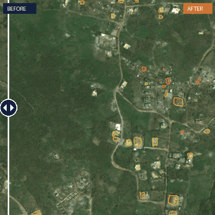
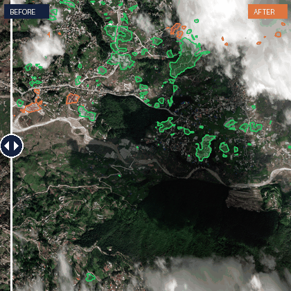
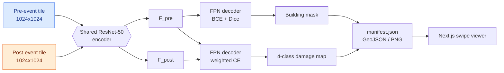

<div align="center">



<br/>

[](https://damagelens.vercel.app)
[](https://pytorch.org)
[](https://nextjs.org)
[](https://www.typescriptlang.org)


**Automated building localization and damage grading from before/after satellite imagery,
with an interactive swipe-to-compare web viewer.**

[Live demo](https://damagelens.vercel.app) · [Architecture](#-architecture) · [Results](#-results) · [Real-world sites](#-real-world-sites) · [Getting started](#-getting-started)

</div>

---

## See it in action

Drag-style before/after comparison on real satellite scenes. Predicted building footprints are coloured by damage tier.

<table>
<tr>
<td align="center" width="50%"><br/><b>Hurricane Matthew</b> (xBD test tile)<br/><sub>33 buildings: 25 minor, 8 destroyed</sub></td>
<td align="center" width="50%"><br/><b>Nepal Floods 2024</b> (Maxar, zero-shot)<br/><sub>125 structures: 98 none, 2 minor, 2 major, 23 destroyed</sub></td>
</tr>
</table>

> The Nepal scene has no ground truth. It shows how the model behaves on imagery it never saw, not a measured accuracy.

---

## What is inside

| | Folder | What it is |
|:-:|:--|:--|
| 🧠 | **`notebook/`** | Self-contained PyTorch training, validation and evaluation pipeline (`SiameseDamageNet`, ResNet-50 backbone, single-GPU) that exports standardized damage assessments |
| 🛰️ | **`frontend/`** | Next.js 14 viewer with before/after swipe, toggleable damage overlays, two dataset profiles, keyboard navigation and evaluation gallery |
| 📜 | **`docs/`** | Data contract between ML inference outputs and the frontend |

---

## 🏗 Architecture



<details>
<summary><b>Pipeline as a flowchart</b></summary>



</details>

- **Model**: `SiameseDamageNet` (~27.3M parameters): a shared `resnet50` encoder (`segmentation-models-pytorch`, ImageNet pretrained) with two lightweight `FPNDecoder` heads (`decoder_dim=128`).
- **Localization head** reads the pre-event features only and learns where buildings are.
- **Damage head** reads `[|F_pre − F_post| ‖ F_post]` at every pyramid level: *what changed* plus *what the building looks like now*.
- **Losses**: localization = 0.5·BCE + 0.5·Dice; damage = class-weighted cross-entropy on ground-truth building pixels.

---

## 🎨 Damage scale



| Tier | Class | Description | Colour |
|:----:|:------|:------------|:------:|
| **0** | No damage | Undamaged structure, intact roof and walls | 🟩 `#22c55e` |
| **1** | Minor | Partially damaged roof, missing tiles or gutters | 🟨 `#eab308` |
| **2** | Major | Partial wall collapse, substantial roof compromise | 🟧 `#f97316` |
| **3** | Destroyed | Structure collapsed, total structural failure | 🟥 `#ef4444` |

### The imbalance problem

Undamaged pixels dominate, so a naive model learns to say "no damage" everywhere. Class weights `w = N / (K · n_c)` fix that.



---

## 📊 Results



Trained at full 1024×1024 with `AdamW` (`lr=1e-4`, `weight_decay=1e-5`) and mixed precision on one NVIDIA L4 across 2,781 filtered xBD pairs (1,946 train / 417 val / 418 test, split by disaster type). Best checkpoint at epoch 7 with early stopping.

| Metric | Test score |
|:-------|:----------:|
| **Localization F1** (binary, threshold 0.5) | `0.8089` |
| **Damage F1, macro** (building pixels) | `0.7055` |
| &nbsp;&nbsp;No damage | `0.9161` |
| &nbsp;&nbsp;Minor | `0.4056` |
| &nbsp;&nbsp;Major | `0.6899` |
| &nbsp;&nbsp;Destroyed | `0.8104` |
| **xView2-style combined score** `0.3 × Loc F1 + 0.7 × Damage macro F1` | `0.7365` |

<details>
<summary><b>How to read these numbers honestly</b></summary>

- Our macro F1 is the **arithmetic** mean of the four class F1s. The official xView2 challenge uses the **harmonic** mean, which punishes a weak class harder. Under that rule this model scores about **0.64** damage and **0.69** combined.
- The split is by disaster type and is **not** the official xView2 split, so these numbers must not be compared with the challenge leaderboard.
- The weakest class is Minor damage (F1 0.41), the hardest to see from above. Major damage is missed more often than over-called (33.5% under-predicted vs 4.2% over).
- Real-world Maxar sites have no ground truth and are qualitative only.

</details>

---

## 🌍 Real-world sites

Beyond the xBD benchmark, the model was run zero-shot on Maxar Open Data scenes: the **Jajarkot earthquake (Nepal)**, **Nepal floods 2024** and the **Sikkim GLOF floods (India)**. Open the [live demo](https://damagelens.vercel.app) to swipe through all of them.

The frontend exposes two dataset profiles under `frontend/public/`:

- **`data/` Benchmark & Disasters (`xBD + Real`)**: 16 scenes, combining 4 xBD test tiles (`Socal Fire`, `Hurricane Matthew`, `Midwest Flooding`, `Hurricane Harvey`) with 12 Maxar scenes, plus `confusion_matrix.png` and `test_predictions.png`.
- **`data1/` Pure Real-World Satellite (`Maxar OOD`)**: 20 Maxar scenes covering the Sikkim flash floods (Teesta basin) and the Jajarkot earthquake.

---

## 🚀 Getting started

### 1. Training & Evaluation (`notebook/`)

The notebook [`notebook/train_and_eval.ipynb`](notebook/train_and_eval.ipynb) is self-contained:

- **Environment**: Designed for Lightning AI Studio with an NVIDIA L4 GPU (24 GB VRAM) or local PyTorch with CUDA.
- **Dataset**: Streams/caches the `train` split of `hannan022/xview2-xbd` via HuggingFace `datasets` (~8 GB on-disk Arrow cache, filtered to hurricane, typhoon, earthquake, flooding, flood, tsunami, and fire disasters; `NUM_WORKERS=0` avoids Arrow copy-on-write RAM growth).
- **Dry-run mode**: Cell 13 runs a synthetic-batch CPU dry run (`256x256`) covering forward pass, loss computation, backward step, checkpoint save/load, and export without downloading the dataset.
- **Optional extensions**: Includes optional ordinal damage loss (Cell 12) and Maxar Open Data STAC OOD inference & manifest export (Cells 14–18).
- **Artifact Generation**: Exports `manifest.json`, `pre.png`, `post.png`, `damage.geojson`, `confusion_matrix.png`, and `test_predictions.png`.

### 2. Visualization Frontend (`frontend/`)

Built with Next.js 14 (App Router), Tailwind CSS, TypeScript, Framer Motion, and React-Leaflet:

```bash
cd frontend
npm install
npm run dev
```

Open [http://localhost:3000](http://localhost:3000) to explore the hero scanner, filter scenes by disaster category or dataset profile, swipe between pre/post satellite imagery, toggle individual damage tiers, or press `?` on a site page for keyboard shortcuts.

To produce an optimized production build:

```bash
npm run build
npm run start
```

---

## Data Contract

To keep the PyTorch training notebook and Next.js frontend decoupled, all inference outputs conform to [`docs/data_contract.md`](docs/data_contract.md):

```text
frontend/public/
├── data/                         # Benchmark & Disasters profile
│   ├── manifest.json
│   ├── confusion_matrix.png
│   ├── test_predictions.png
│   └── <site_id>/
│       ├── pre.png
│       ├── post.png
│       └── damage.geojson
└── data1/                        # Pure Real-World Satellite profile
    ├── manifest.json
    └── <site_id>/
        ├── pre.png
        ├── post.png
        └── damage.geojson
```

---

## 🔌 Data contract

To keep the PyTorch notebook and the Next.js frontend decoupled, all inference outputs follow [`docs/data_contract.md`](docs/data_contract.md):

```text
frontend/public/
├── data/                         # Benchmark & Disasters profile
│   ├── manifest.json
│   ├── confusion_matrix.png
│   ├── test_predictions.png
│   └── <site_id>/
│       ├── pre.png
│       ├── post.png
│       └── damage.geojson
└── data1/                        # Pure Real-World Satellite profile
    ├── manifest.json
    └── <site_id>/
        ├── pre.png
        ├── post.png
        └── damage.geojson
```

---

## 🧰 Tech stack

- **Model & Training**: PyTorch 2.5, Torchvision, `segmentation-models-pytorch`, HuggingFace `datasets`, Albumentations, OpenCV, Rasterio, Shapely, GeoPandas, Matplotlib, scikit-learn, SciPy, `pystac-client`, `leafmap`, `rio-tiler`
- **Frontend**: Next.js 14 (App Router), React 18, TypeScript, Tailwind CSS, Framer Motion, React-Leaflet / Leaflet, Lucide Icons
- **Fonts & Typography**: Self-hosted Archivo Variable (`@fontsource-variable/archivo`) & IBM Plex Mono (`@fontsource/ibm-plex-mono`)


---

<div align="center">
<sub>Built with PyTorch, Next.js and a lot of satellite pixels. Imagery: xBD dataset and Maxar Open Data.</sub>
</div>
